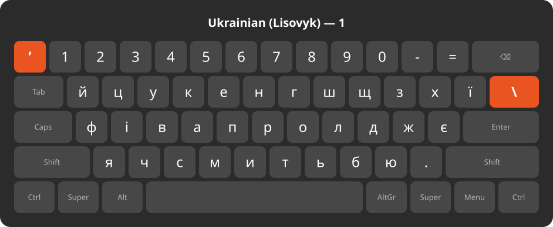
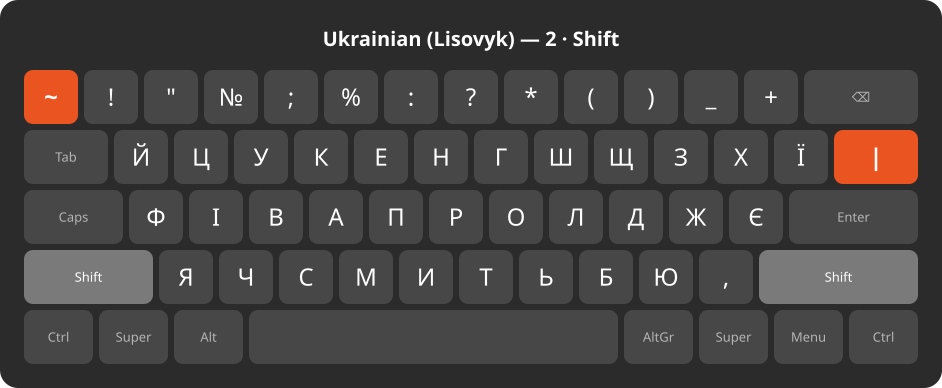
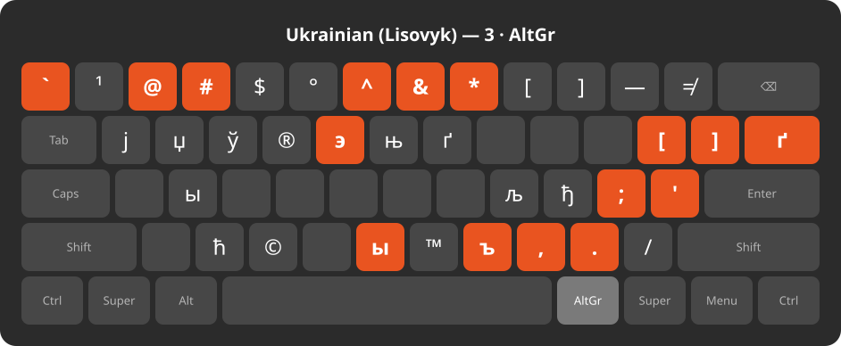
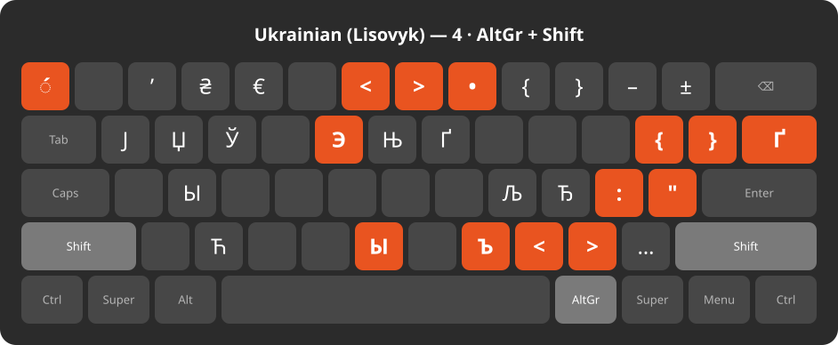

# lisovyk

[Українською](README.md) | English

Custom keyboard layout variants for Linux, installed without root privileges. The repository is
split into a generic installer, `install.sh`, and per-layout data under `layouts/<name>/`. There is
currently one layout: `layouts/lisovyk/`, a Ukrainian variant called "Lisovyk".

## Contents

- [The Lisovyk layout](#the-lisovyk-layout)
- [Installing](#installing)
- [Compatibility](#compatibility)
- [Layout data format](#layout-data-format)
- [Tests](#tests)
- [License](#license)

## The Lisovyk layout

`lisovyk` derives from the default Ukrainian XKB layout (`ua`), which is itself the
[Ukrainian Unicode](https://r2u.org.ua/wiki/keyboard/UkrainianUnicode) layout by r2u.org.ua. It
overrides only some keys on top of that base (see `layouts/lisovyk/keys.xkb` for the exact list):

- `\` and `|` are on levels 1–2 of their key, and `ґ`/`Ґ` move to levels 3–4;
- levels 3–4 (with right Alt) give the punctuation of the US layout: `[ ] { }` on `х`/`ї`,
  `; : ' "` on `ж`/`є`, `, . < >` on `б`/`ю`, `@ # ^ & *` on the digits;
- the key left of `1` gives the apostrophe `ʼ` (U+02BC), `~`, `` ` `` and the stress mark (U+0301): typed
  after a vowel, it puts an accent over it, as in «за́мок» and «замо́к»;
- `э`, `ъ`, `ы` are on levels 3–4 of the `е`, `ь`, `и` keys; `ы` also stays on the `і` key, as in the base layout.

Levels 3 and 4 are typed with right Alt (AltGr) and AltGr+Shift.

Why these particular remappings were chosen, with the pros and cons of each, is explained in a
separate document: [Why Lisovyk is laid out this way](layouts/lisovyk/README.en.md).

In the illustrations, orange marks the keys that differ from the base Ukrainian layout on that
level; grey marks the modifiers to hold.






The illustrations are generated by `tools/render_layout.py` from the compiled layout; run it again
after editing `keys.xkb`.

## Installing

```bash
./install.sh              # install or update every layout found under layouts/
./install.sh --uninstall  # remove every layout found under layouts/
```

Running `./install.sh` again updates layouts that are already installed, so after editing `keys.xkb`
just run it once more.

After installing, log out and back in, then enable the layout. In GNOME:

```bash
gsettings set org.gnome.desktop.input-sources sources "[('xkb', 'us'), ('xkb', 'ua+lisovyk')]"
```

This command replaces the whole list of input sources. If you have other layouts, add "Ukrainian
(Lisovyk)" through Settings → Keyboard → Input Sources instead. `install.sh` prints the exact
`gsettings` command for whatever it just installed.

Other environments enable the layout through their own configuration:

```
# Hyprland (hyprland.conf)
input {
    kb_layout = us,ua
    kb_variant = ,lisovyk
}

# niri (config.kdl)
input {
    keyboard {
        xkb {
            layout "us,ua"
            variant ",lisovyk"
        }
    }
}

# Sway (config)
input type:keyboard {
    xkb_layout us,ua
    xkb_variant ,lisovyk
}
```

## Compatibility

The script writes only to `~/.config/xkb/` (or `$XDG_CONFIG_HOME/xkb/` when that variable is set).
That directory is read by `libxkbcommon`; version 1.0.0 or newer (September 2020) is required, so what matters is not the distribution but whether `libxkbcommon` is the thing
compiling the keymap. Wayland compositors use it. The X server compiles keymaps with `xkbcomp` from
the system directory and never looks at `~/.config/xkb/`.

Tested in practice:

| System | Environment | Versions |
| --- | --- | --- |
| Ubuntu 26.04 | GNOME 50 (Wayland) | libxkbcommon 1.13.1, xkeyboard-config 2.46 |
| Fedora 44 | GNOME (Wayland) | — |

The rest of this table is expected behaviour, derived from how these environments work; the layout
has not been run on them.

| Environment | Works | Note |
| --- | --- | --- |
| GNOME on Wayland, 42 and newer | yes | the layout shows up in the input source list |
| GNOME on Wayland, older than 42 | partly | the input source list does not see the layout |
| Hyprland, niri, Sway and other Wayland compositors | yes | configured by hand, see above |
| KDE Plasma on Wayland | probably | KWin will compile the keymap; whether the settings window lists it is untested. The fallback is `LayoutList` and `VariantList` in `~/.config/kxkbrc` |
| Any environment on X11 (XFCE, GNOME or KDE on Xorg) | no | needs a system-wide install into `/usr/share/X11/xkb` with root, which this script does not do |
| Headless server, SSH | not applicable | the text console does not use XKB, and an SSH session uses the client's layout |
| Login screen (GDM, SDDM) | no | the install applies to your user only |

Minimum distribution releases for GNOME, going by the GNOME version they ship: Ubuntu 22.04, Debian
12, Fedora 36, current Arch. Applications running through Xwayland get their keymap from the
compositor, so the layout works in them inside a Wayland session.

The script needs `bash`, `sed` and `awk` (tested with `mawk`), plus the system `xkeyboard-config`
data containing the base layout.

If you installed the layout with an older version of the script, just run `./install.sh` again: it
removes the unneeded copy of the system `symbols/ua` file and the obsolete rule in `rules/evdev`.

## Layout data format

Each layout directory (`layouts/<name>/`) needs exactly two files (illustrations and a README with
the rationale may sit next to them):

- **`layout.conf`** — shell-sourced metadata: `BASE_LAYOUT` (the system XKB layout to extend, e.g.
  `ua`), `BASE_VARIANT` (the variant of it to build on, e.g. `unicode`; defaults to `basic`),
  `VARIANT` (the new variant's internal name), `DESCRIPTION` (the name shown in the input source
  list).
- **`keys.xkb`** — just the body: `key <...> { [ ... ] };` lines and comments, indented 4 spaces.
  `install.sh` wraps them in `partial alphanumeric_keys` / `xkb_symbols "$VARIANT" { include
  "$BASE_LAYOUT($BASE_VARIANT)"; name[Group1]= "$DESCRIPTION"; ... }`, so `keys.xkb` must not contain that
  boilerplate.

To add a layout, add a `layouts/<name>/` directory. `install.sh` itself does not need to change.

## Tests

```bash
tests/run.sh                # all tests
tests/run.sh fresh_install  # only the named ones
```

The tests run `install.sh` against a temporary directory in place of the home directory, so your
real `~/.config/xkb` is never touched. Results are checked with the same libraries compositors use:
`libxkbcommon` compiles the keymap and compares every key's symbols with `keys.xkb`, and
`libxkbregistry` looks the variant up in the registry. A separate test checks that the illustrations
match the current `keys.xkb`. They need `python3`, `libxkbcommon` and
`libxkbregistry`; `shellcheck` runs when installed.

## License

[MIT](LICENSE).
