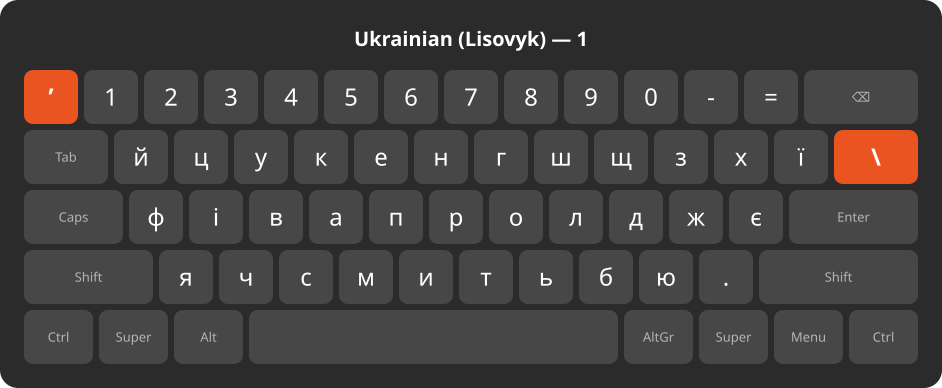
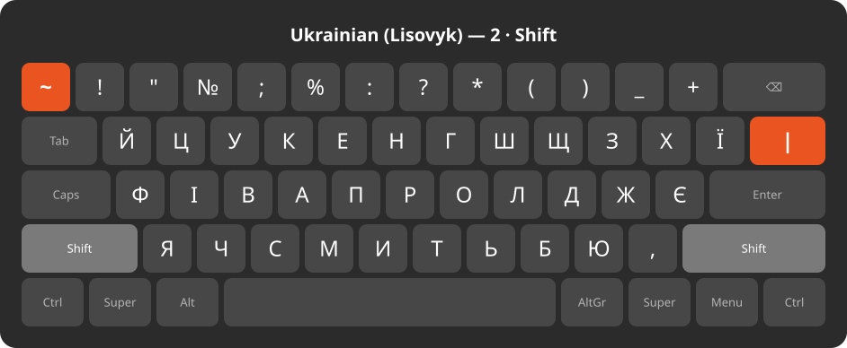
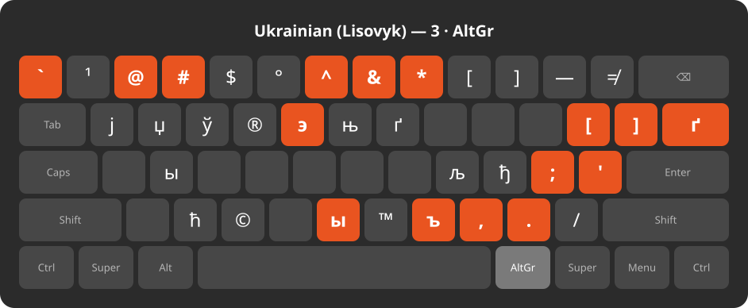
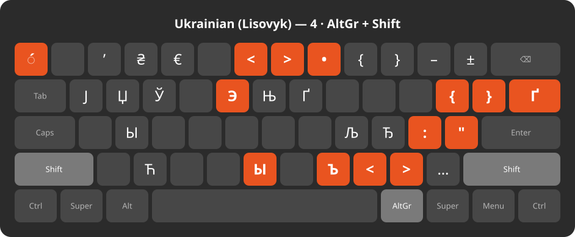

# lisovyk

Українською | [English](README.en.md)

Власні варіанти клавіатурних розкладок для Linux, які встановлюються без root-прав. Репозиторій
складається із загального інсталятора `install.sh` та даних розкладок у `layouts/<назва>/`. Зараз
розкладка одна — `layouts/lisovyk/`, український варіант «Lisovyk».

## Зміст

- [Розкладка Lisovyk](#розкладка-lisovyk)
- [Встановлення](#встановлення)
- [Сумісність](#сумісність)
- [Формат даних розкладки](#формат-даних-розкладки)
- [Тести](#тести)
- [Ліцензія](#ліцензія)

## Розкладка Lisovyk

`lisovyk` — похідна від стандартної української розкладки XKB (`ua`), яка своєю чергою є розкладкою
[Ukrainian Unicode](https://r2u.org.ua/wiki/keyboard/UkrainianUnicode) від r2u.org.ua. Поверх бази
перевизначено лише частину клавіш (точний перелік — у `layouts/lisovyk/keys.xkb`):

- `\` та `|` стоять на 1–2 рівнях своєї клавіші, а `ґ`/`Ґ` — на 3–4;
- на 3–4 рівнях (з правим Alt) доступні знаки з американської розкладки: `[ ] { }` на `х`/`ї`,
  `; : ' "` на `ж`/`є`, `, . < >` на `б`/`ю`, `@ # ^ & *` на цифрах;
- клавіша ліворуч від `1` дає апостроф `ʼ` (U+02BC), `~`, `` ` `` та знак наголосу (U+0301): набраний
  після голосної, він ставить над нею риску, як у «за́мок» і «замо́к»;
- `э`, `ъ`, `ы` доступні на 3–4 рівнях клавіш `е`, `ь`, `и`; `ы` лишається також на клавіші `і`, як у базовій розкладці.

Рівні 3 та 4 набираються з правим Alt (AltGr) та AltGr+Shift.

Чому обрано саме такі заміни, з перевагами й недоліками кожної, пояснено в окремому документі:
[Чому Lisovyk влаштована саме так](layouts/lisovyk/README.md).

На ілюстраціях помаранчевим виділено клавіші, які на цьому рівні відрізняються від базової
української розкладки; сірим — модифікатори, які треба тримати.






Ілюстрації генерує `tools/render_layout.py` зі скомпільованої розкладки; після правок у `keys.xkb`
запустіть його ще раз.

## Встановлення

```bash
./install.sh              # встановити або оновити всі розкладки з layouts/
./install.sh --uninstall  # видалити всі розкладки з layouts/
```

Повторний запуск `./install.sh` оновлює вже встановлені розкладки, тож після правок у `keys.xkb`
достатньо запустити його ще раз.

Після встановлення вийдіть із сесії та увійдіть знову, а потім увімкніть розкладку. У GNOME:

```bash
gsettings set org.gnome.desktop.input-sources sources "[('xkb', 'us'), ('xkb', 'ua+lisovyk')]"
```

Ця команда замінює весь список джерел вводу. Якщо у вас є інші розкладки, додайте «Ukrainian
(Lisovyk)» через «Параметри → Клавіатура → Джерела вводу». `install.sh` сам друкує точну команду
`gsettings` для щойно встановлених розкладок.

В інших середовищах розкладку вмикають їхніми власними налаштуваннями:

```
# Hyprland (hyprland.conf)
input {
    kb_layout = us,ua
    kb_variant = ,lisovyk
}

# niri (config.kdl)
input {
    keyboard {
        xkb {
            layout "us,ua"
            variant ",lisovyk"
        }
    }
}

# Sway (config)
input type:keyboard {
    xkb_layout us,ua
    xkb_variant ,lisovyk
}
```

## Сумісність

Скрипт пише файли лише в `~/.config/xkb/` (або в `$XDG_CONFIG_HOME/xkb/`, якщо цю змінну задано).
Цю теку читає `libxkbcommon`; потрібна версія 1.0.0 або новіша (вересень 2020), тому все залежить не від дистрибутива, а від того, чи компонує розкладку саме
`libxkbcommon`. Так роблять композитори Wayland. X-сервер компонує розкладку через `xkbcomp` із
системної теки й `~/.config/xkb/` не бачить.

Перевірено на практиці:

| Система | Середовище | Версії |
| --- | --- | --- |
| Ubuntu 26.04 | GNOME 50 (Wayland) | libxkbcommon 1.13.1, xkeyboard-config 2.46 |
| Fedora 44 | GNOME (Wayland) | — |

Решта таблиці — очікувана поведінка, виведена з того, як працюють ці середовища; на них розкладку
не запускали.

| Середовище | Чи працює | Примітка |
| --- | --- | --- |
| GNOME на Wayland, 42 і новіші | так | розкладка зʼявляється у списку джерел вводу |
| GNOME на Wayland, до 42 | частково | список джерел вводу не бачить розкладку |
| Hyprland, niri, Sway та інші композитори Wayland | так | налаштування вручну в конфігурації, див. вище |
| KDE Plasma на Wayland | імовірно | KWin розкладку скомпонує; чи покаже її вікно налаштувань, не перевірено. Запасний шлях — `LayoutList` і `VariantList` у `~/.config/kxkbrc` |
| Будь-яке середовище на X11 (XFCE, GNOME чи KDE на Xorg) | ні | потрібне системне встановлення в `/usr/share/X11/xkb` з root-правами, цей скрипт його не робить |
| Сервер без графіки, SSH | не стосується | текстова консоль не використовує XKB, а в SSH-сесії діє розкладка клієнта |
| Екран входу (GDM, SDDM) | ні | встановлення діє лише для вашого користувача |

Мінімальні версії дистрибутивів для GNOME, виходячи з версії GNOME у них: Ubuntu 22.04, Debian 12,
Fedora 36, поточний Arch. Програми, що працюють через Xwayland, отримують розкладку від композитора,
тому в сесії Wayland вона діє й у них.

Скрипт потребує `bash`, `sed` та `awk` (перевірено з `mawk`), а також системних даних
`xkeyboard-config` з базовою розкладкою.

Якщо ви встановлювали розкладку старою версією скрипта, просто запустіть `./install.sh` ще раз: він
прибере зайву копію системного файла `symbols/ua` та застаріле правило в `rules/evdev`.

## Формат даних розкладки

Кожна тека розкладки (`layouts/<назва>/`) містить рівно два обовʼязкові файли (поруч можуть лежати
ілюстрації та README з поясненнями):

- **`layout.conf`** — метадані у форматі оболонки: `BASE_LAYOUT` (системна розкладка XKB, яку
  розширюємо, наприклад `ua`), `BASE_VARIANT` (її варіант, який беремо за основу, наприклад
  `unicode`; якщо не вказати — `basic`), `VARIANT` (внутрішня назва нового варіанта), `DESCRIPTION`
  (назва, яку показує список джерел вводу).
- **`keys.xkb`** — лише тіло: рядки `key <...> { [ ... ] };` та коментарі з відступом у 4 пробіли.
  `install.sh` сам обгортає їх у `partial alphanumeric_keys` / `xkb_symbols "$VARIANT" { include
  "$BASE_LAYOUT($BASE_VARIANT)"; name[Group1]= "$DESCRIPTION"; ... }`, тож у `keys.xkb` цього шаблону бути
  не повинно.

Щоб додати нову розкладку, додайте теку `layouts/<назва>/`. Сам `install.sh` змінювати не потрібно.

## Тести

```bash
tests/run.sh                # усі тести
tests/run.sh fresh_install  # лише вказані
```

Тести запускають `install.sh` у тимчасовій теці замість домашньої, тому справжній `~/.config/xkb`
не зачіпають. Результат перевіряють тими самими бібліотеками, якими користуються композитори:
`libxkbcommon` компілює розкладку й звіряє символи кожної клавіші з `keys.xkb`, `libxkbregistry`
шукає варіант у реєстрі. Окремий тест перевіряє, що ілюстрації відповідають поточному `keys.xkb`.
Потрібні `python3`, `libxkbcommon` та `libxkbregistry`; `shellcheck`
запускається, якщо встановлений.

## Ліцензія

[MIT](LICENSE).
